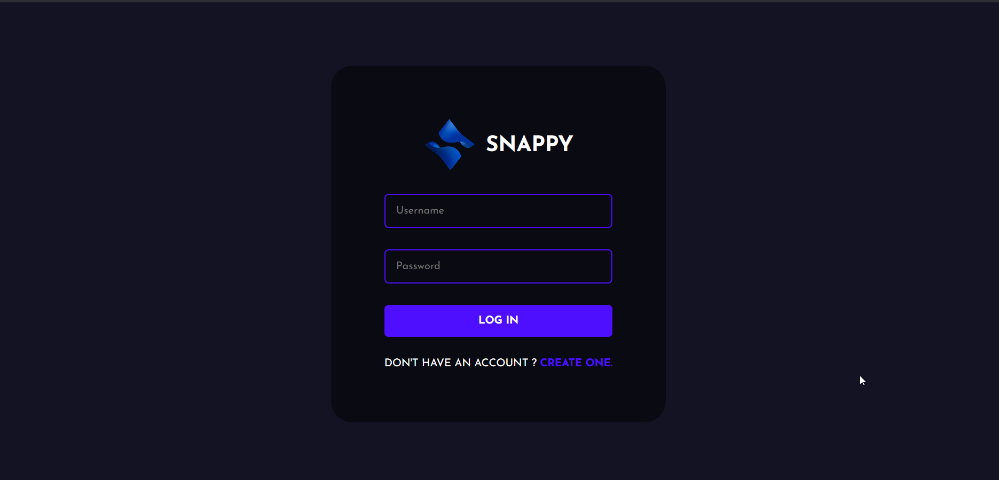
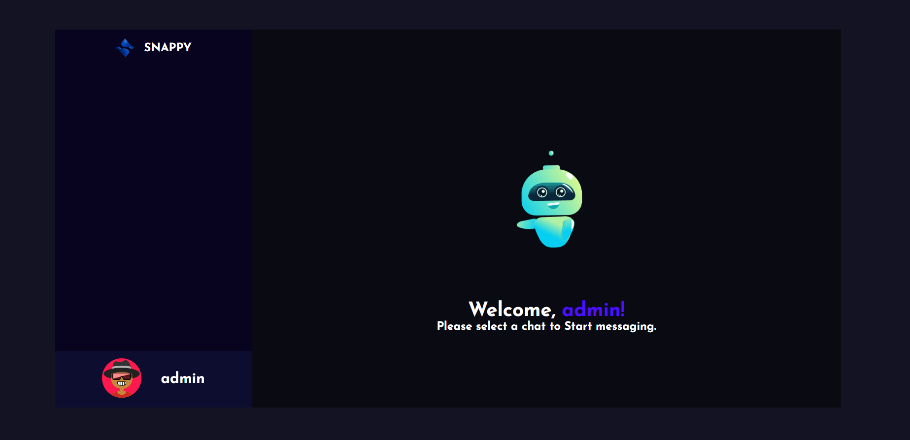

# Snappy - Real-Time Chat Application 

Snappy is a modern, real-time chat application built with the powerful MERN Stack (MongoDB, Express.js, React, Node.js) and Socket.IO for seamless instant messaging. The application features user authentication, customizable avatars, emoji support, and real-time online status tracking.

## 🚀 Features

- **Real-time Messaging**: Instant message delivery using Socket.IO
- **User Authentication**: Secure registration and login system with bcrypt password hashing
- **Avatar Customization**: Personalized avatar selection and setup
- **Online Status**: Real-time tracking of online users
- **Emoji Support**: Rich emoji picker for expressive messaging
- **Responsive Design**: Modern UI built with styled-components
- **Message History**: Persistent message storage and retrieval
- **User Management**: Contact list and user discovery

## 🛠️ Technology Stack

### Frontend
- **React 17**: Modern JavaScript library for building user interfaces
- **React Router DOM**: Client-side routing and navigation
- **Socket.IO Client**: Real-time bidirectional event-based communication
- **Styled Components**: CSS-in-JS library for styling
- **Axios**: HTTP client for API requests
- **React Toastify**: Elegant notifications and alerts
- **Emoji Picker React**: Interactive emoji selection

### Backend
- **Node.js**: JavaScript runtime environment
- **Express.js**: Fast, minimalist web framework
- **Socket.IO**: Real-time communication engine
- **MongoDB**: NoSQL database for data persistence
- **Mongoose**: MongoDB object modeling library
- **bcrypt**: Password hashing and security
- **CORS**: Cross-origin resource sharing middleware
- **dotenv**: Environment variable management

## 📁 Project Structure

```
Chat-App/
├── public/                 # Frontend React Application
│   ├── src/
│   │   ├── components/     # Reusable React components
│   │   │   ├── ChatContainer.jsx
│   │   │   ├── ChatInput.jsx
│   │   │   ├── Contacts.jsx
│   │   │   ├── Logout.jsx
│   │   │   ├── SetAvatar.jsx
│   │   │   └── Welcome.jsx
│   │   ├── pages/          # Main application pages
│   │   │   ├── Chat.jsx
│   │   │   ├── Login.jsx
│   │   │   └── Register.jsx
│   │   ├── assets/         # Static assets (images, icons)
│   │   ├── utils/          # Utility functions and API routes
│   │   ├── App.js          # Main application component
│   │   └── index.js        # Application entry point
│   ├── package.json        # Frontend dependencies
│   └── Dockerfile          # Frontend Docker configuration
├── server/                 # Backend Node.js Application
│   ├── controllers/        # Business logic controllers
│   │   ├── messageController.js
│   │   └── userController.js
│   ├── models/             # MongoDB data models
│   │   ├── messageModel.js
│   │   └── userModel.js
│   ├── routes/             # API route definitions
│   │   ├── auth.js
│   │   └── messages.js
│   ├── index.js            # Server entry point
│   ├── package.json        # Backend dependencies
│   └── Dockerfile          # Backend Docker configuration
├── images/                 # Application screenshots
├── docker-compose.yml      # Multi-container Docker setup
└── README.md              # Project documentation
```

## 🏗️ Architecture Overview

The application follows a client-server architecture with real-time communication:

1. **Frontend (React)**: Single-page application handling user interface and client-side logic
2. **Backend (Express.js)**: RESTful API server managing authentication, user data, and message persistence
3. **Real-time Layer (Socket.IO)**: Bidirectional communication for instant messaging
4. **Database (MongoDB)**: Document-based storage for users and messages

### Data Flow
1. User authenticates through React frontend
2. Frontend establishes Socket.IO connection with backend
3. Messages sent via Socket.IO for real-time delivery
4. Messages persisted to MongoDB for history
5. Online status managed through Socket.IO connection events

## 📊 Database Schema

### User Model
```javascript
{
  username: String (required, unique, 3-20 characters),
  email: String (required, unique, max 50 characters),
  password: String (required, hashed, min 8 characters),
  isAvatarImageSet: Boolean (default: false),
  avatarImage: String (default: "")
}
```

### Message Model
```javascript
{
  message: {
    text: String (required)
  },
  users: Array (sender and receiver IDs),
  sender: ObjectId (reference to User),
  timestamps: true (createdAt, updatedAt)
}
```

## 🔌 API Endpoints

### Authentication Routes (`/api/auth`)
- `POST /register` - User registration
- `POST /login` - User login
- `GET /allusers/:id` - Get all users except current user
- `POST /setavatar/:id` - Set user avatar
- `GET /logout/:id` - User logout

### Message Routes (`/api/messages`)
- `POST /addmsg` - Send a new message
- `POST /getmsg` - Retrieve message history between users

### Health Check
- `GET /ping` - Server health check

## 🖼️ Application Screenshots

### Login Page


### Chat Interface


## 🚀 Quick Start

### Prerequisites
- [Node.js](https://nodejs.org/en/download) (v14 or higher)
- [MongoDB](https://www.mongodb.com/docs/manual/administration/install-community/) (running locally or cloud instance)
- [Git](https://git-scm.com/downloads)

### 📋 Installation

#### Method 1: Local Development

1. **Clone the repository**
```bash
git clone https://github.com/rahulk736694/Chat-App.git
cd Chat-App
```

2. **Set up environment variables**

The project already includes configured `.env` files. If you need to modify them:

```bash
# Frontend environment configuration is in public/.env
# Backend environment configuration is in server/.env
# Modify these files as needed for your setup
```

3. **Install dependencies**
```bash
# Install backend dependencies
cd server
npm install
# or yarn install

# Install frontend dependencies
cd ../public
npm install
# or yarn install
```

4. **Start the application**

**Terminal 1 - Start Backend Server:**
```bash
cd server
npm start
# Server will run on http://localhost:5000
```

**Terminal 2 - Start Frontend Development Server:**
```bash
cd public
npm start
# React app will run on http://localhost:3000
```

5. **Open your browser**
Navigate to `http://localhost:3000` to access the application.

#### Method 2: Docker Deployment

1. **Prerequisites**: Docker and Docker Compose installed

2. **Clone and build**
```bash
git clone https://github.com/rahulk736694/Chat-App.git
cd Chat-App
docker compose build --no-cache
```

3. **Run the application**
```bash
docker compose up
```

4. **Access the application**
Open `http://localhost:3000` in your browser.

### 🔧 Environment Variables

#### Frontend (.env)
```env
REACT_APP_LOCALHOST_KEY=user-key
```

#### Backend (.env)
```env
PORT=5000
MONGO_URL="mongodb://localhost:27017/chat"
```

**Note**: The frontend API host is configured in `public/src/utils/APIRoutes.js` and currently points to `http://localhost:5000`.

## 🎯 Usage Guide

1. **Registration**: Create a new account with username, email, and password
2. **Avatar Setup**: Choose and set your personalized avatar
3. **Login**: Access your account with credentials
4. **Start Chatting**: Select a contact and begin real-time messaging
5. **Enjoy Features**: Use emojis, see online status, and enjoy seamless communication

## 🔧 Development

### Running Tests
```bash
# Frontend tests
cd public
npm test

# Backend tests (if available)
cd server
npm test
```

### Building for Production
```bash
# Build frontend
cd public
npm run build

# The build folder will contain optimized production files
```

## 🐛 Troubleshooting

### Common Issues

1. **MongoDB Connection Error**
   - Ensure MongoDB is running locally or check your connection string
   - Verify network connectivity to MongoDB instance

2. **Port Already in Use**
   - Change ports in environment variables
   - Kill processes using required ports: `lsof -ti:3000 | xargs kill -9`

3. **Dependencies Issues**
   - Clear node_modules: `rm -rf node_modules package-lock.json`
   - Reinstall: `npm install`

4. **Socket.IO Connection Issues**
   - Check CORS configuration in server
   - Verify frontend and backend URLs match

5. **React Hook Warnings**
   - The application may show ESLint warnings about React Hooks dependencies
   - These warnings don't affect functionality in development mode
   - For production builds, consider addressing the warnings or adjusting ESLint configuration

## 🤝 Contributing

1. **Fork the repository**
2. **Create a feature branch**: `git checkout -b feature/amazing-feature`
3. **Make your changes**: Implement your feature or bug fix
4. **Commit your changes**: `git commit -m 'Add amazing feature'`
5. **Push to the branch**: `git push origin feature/amazing-feature`
6. **Open a Pull Request**: Describe your changes and submit for review

### Development Guidelines
- Follow existing code style and conventions
- Write meaningful commit messages
- Test your changes thoroughly
- Update documentation as needed

## 📝 License

This project is open source and available under the [MIT License](LICENSE).

## 🙏 Acknowledgments

- Built with the powerful MERN stack
- Socket.IO for real-time communication
- React community for excellent libraries
- MongoDB for flexible data storage

## 📞 Support

If you encounter any issues or have questions:
1. Check the [Issues](https://github.com/rahulk736694/Chat-App/issues) page
2. Create a new issue with detailed information
3. Provide steps to reproduce the problem

---

**Happy Chatting! 💬**
